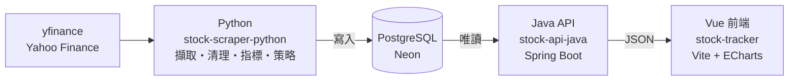

# 股票追蹤與分析系統（stock-tracker-system）

台股觀察名單的行情追蹤系統：股票清單與最新報價、互動式 K 線圖、技術指標（MA / MACD / RSI / KD），以及技術策略選股。
採 Monorepo 管理三個獨立服務，各自負責資料處理、API 與畫面。

## 架構

| 服務 | 目錄 | 職責 | 技術 |
|---|---|---|---|
| 資料擷取 | [`stock-scraper-python/`](stock-scraper-python/README.md) | 擷取日 K、清理資料、計算技術指標、掃描選股策略，寫入資料庫 | Python 3.12、yfinance、Pandas、TA-Lib、SQLAlchemy |
| 後端 API | [`stock-backend-java/stock-api-java/`](stock-backend-java/stock-api-java/README.md) | 讀取資料庫，提供 RESTful API | Java 17、Spring Boot、Spring Data JPA、Maven |
| 前端 | [`stock-frontend-vue/stock-tracker/`](stock-frontend-vue/stock-tracker/README.md) | 股票清單、K 線圖與指標、策略選股頁 | Vue 3、Vite、Vue Router、ECharts |

職責分離原則：

- **只有 Python 寫入資料庫**，資料表也由 Python 建立；Java 只讀取（啟動時以 `ddl-auto=validate` 檢查結構）
- **Vue 只透過 Java API 取得資料**，不直接連線資料庫
- 技術指標與策略都由 Python 計算後存入資料庫，圖表與選股使用同一份數字

各服務的安裝、設定與執行細節請見各自的 README。

## 快速開始

需要依序啟動。第一次使用前，請先在各服務完成安裝與環境變數設定。

| 順序 | 服務 | 指令 | 說明 |
|---|---|---|---|
| 1 | Python | `cd stock-scraper-python && ./scripts/run_daily.sh` | 建立資料表並寫入資料；之後每天收盤後執行一次即可：可在 Finder 點兩下 `scripts/update-stock-data.command`，或用 `scripts/install_schedule.sh` 安裝每日自動排程 |
| 2 | Java | IntelliJ 執行 `StockApiJavaApplication` | API 位於 `http://localhost:8081` |
| 3 | Vue | `cd stock-frontend-vue/stock-tracker && npm run dev` | 開啟 `http://localhost:5173` |

官方開放資料（`official_*` 資料表）另由 GitHub Actions 在私人 repo 每天自動累積，見 [Python README](stock-scraper-python/README.md#雲端每日排程github-actions)。

環境需求：Python 3.11 以上（建議 3.12）、JDK 17 以上、Node.js 20.19 / 22.12 以上（建議 24 LTS）、PostgreSQL（目前使用 Neon）。

## 環境變數與機敏資料

| 變數 | Python | Java | 說明 |
|---|---|---|---|
| `DB_URL` | ✓ | ✓ | 兩邊可共用 JDBC 格式：`jdbc:postgresql://<host>:5432/<db>?sslmode=require`（Python 會自動轉換） |
| `DB_USERNAME` | ✓ | ✓ | 資料庫帳號 |
| `DB_PASSWORD` | ✓ | ✓ | 資料庫密碼 |
| `PORT` |  | ✓ | Java API port，預設 8081 |
| `VITE_API_BASE_URL` |  |  | Vue 使用的 API 位址，預設 `http://localhost:8081`（會打包進前端，只能放公開資訊） |

- 真實值放在 `stock-scraper-python/.env`（Python）與 IntelliJ Run Configuration（Java），兩者都不會進 Git
- 各服務提供 `.env.example` 範本，只含佔位符
- `.env` 建議設為只有自己能讀：`chmod 600 stock-scraper-python/.env`

## 資料表

全部由 Python 建立與寫入：

| 資料表 | 內容 | 識別方式 |
|---|---|---|
| `stocks` | 股票基本資料（代號、名稱、幣別） | `symbol` |
| `stock_prices` | 日 K：開高低收、成交量（2015-06-01 起） | `(symbol, trade_date)` 唯一 |
| `stock_actions` | 除權息與股本事件：現金股利、配股 / 減資 / 分割比例（回測計算還原報酬用） | `(symbol, ex_date)` 唯一 |
| `stock_indicators` | MA5/10/20/60、MACD、RSI6/12、KD、ATR14 | 與 `stock_prices` 一對一（外鍵） |
| `strategy_signals` | 某股票某交易日符合某策略 | `(symbol, trade_date, strategy)` 唯一 |
| `backtest_trades` | 策略回測的每筆交易（4 種出場規則） | `(strategy, symbol, exit_rule, entry_date)` 唯一 |
| `backtest_stats` | 策略回測統計（個別股票與全部合併），含任意日進場與買進持有基準 | `(strategy, scope, exit_rule)` 唯一 |
| `official_daily_quotes` | 證交所 / 櫃買中心開放資料的原始日成交資訊（全部股票與 ETF，每日累積，目前尚未用於畫面） | `(market, code, trade_date)` 唯一 |
| `official_corporate_actions` | 證交所 / 櫃買中心的除權除息預告（現金股利、配股比例，每日累積） | `(market, code, ex_date)` 唯一 |

資料來源：觀察名單的 K 線、指標與策略使用 yfinance（個人使用）；`official_daily_quotes` 來自臺灣證券交易所與證券櫃檯買賣中心的開放資料，依[政府資料開放授權條款－第 1 版](https://data.gov.tw/license)使用。

資料驗證查詢：[`stock-scraper-python/sql/verify.sql`](stock-scraper-python/sql/verify.sql)

## 資料性質與限制

- **日收盤價，非即時報價**：資料來源為 yfinance 日 K，畫面上標示報價日期；盤中執行時會略過當天尚未收盤的資料
- **未還原除息**：與券商報價一致，除息日 K 線會有跳空缺口；股票分割已由資料來源調整
- **只計交易日**：週末、國定假日與颱風假不會出現；yfinance 在休市日偶爾補上的假 K 線（成交量 0、開高低收相同）會被排除
- **資料來源缺漏**：yfinance 偶有少數交易日缺漏，已知日期列在 `verify.sql` 查詢 8
- **觀察名單**：設定在 `stock-scraper-python/scraper/config.py` 的 `WATCHLIST`

## 測試

| 服務 | 指令 | 是否需要資料庫 |
|---|---|---|
| Python | `cd stock-scraper-python && python -m pytest` | 不需要（只用程式內產生的資料） |
| Java | `cd stock-backend-java/stock-api-java && ./mvnw test` | 需要：啟動完整應用程式並連線資料庫（只讀取），詳見 Java README |

## 開發路線圖

規劃中的功能與調整見 [TODO.md](TODO.md)。
